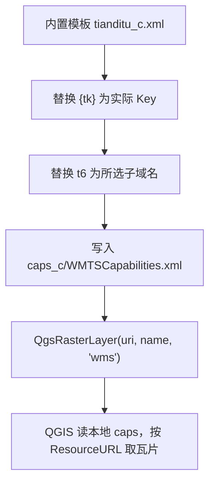

天地图的瓦片有两种：带 `_w` 后缀的是 Web 墨卡托（EPSG:3857），QGIS 用 XYZ 就能加，最省事；带 `_c` 后缀的是经纬度（EPSG:4490 / CGCS2000），只能用 WMTS。

我手上的数据本来就是 4490（国土、规划项目里很常见），如果用 `_w` 底图，QGIS 得在两套坐标系之间重投影一次，等于白白多一层重采样。所以给插件补了 `_c` 图层。补的过程不太顺，遇到两个问题，都跟 QGIS 怎么使用 capabilities 有关。

## 为什么 XYZ 方式不行

QGIS 的 XYZ provider 只认 3857。`qgswmscapabilities.cpp` 里 `QgsWmsSettings::parseUri()` 的 XYZ 分支是写死的，想用 4490 只能换 WMTS provider。

## 瓦片请求返回 403

用 WMTS 加载 `_c`，capabilities 能正常读取，但是访问不到瓦片。

QGIS 取瓦片时不用我们传进去的 URL，而是去 capabilities 里找 `GetTile` 公布的端点（`createTileRequestsWMTS()`）：

```cpp
if ( !getTileUrl().isNull() )
{
  QString baseUrl = mSettings.mIgnoreGetMapUrl ? mSettings.mBaseUrl : getTileUrl();
```

天地图公布的端点长这样：

```xml
<ows:Operation name="GetTile">
  <ows:Get xlink:href="http://t0.tianditu.gov.cn/vec_c/wmts?"/>
```

这个 href 本身不带 `tk`。令牌挂在我们请求 capabilities 时用的 URL 上，QGIS 不会把它一起带过去，于是每个瓦片请求都缺 token，返回 403。

## 图层整体偏移

绕过 tk（比如加 `IgnoreGetMapUrl=1`）之后图能出来，但是位置不对：越往东南偏得越多，像是整幅图被放大了一圈。


问题出在比例尺上。QGIS 按标准规定的 0.28mm 像素反算分辨率（`tileMatrix.tres = scaleDenom * 0.00028 / metersPerUnit`），而天地图 `_c` 的 `ScaleDenominator` 是按 96 DPI 算的。两边口径不一致，QGIS 以为每片瓦片比实际大，整幅图也就跟着放大了。

> 虽然天地图也提供了`https://t0.tianditu.gov.cn/vec_c/esri/wmts` 标准0.28mm矩阵集，但是 GetTile 还是原来的，所有 QGIS 仍然无法通过这个正确访问，Arcmap会将 tk 传递到 GetTile，因此可以正常访问。

## 改用本地 caps

WMTS provider 支持从本地文件读 capabilities（`url=file:///...`）。官方提供的这两处都不对，那就自己准备一份，让 QGIS 直接读。

插件里内置了一个模板 `tianditu_tools/maps/tianditu_c.xml`，生成时只替换两个地方：



### ResourceURL 带 tk

不用往 `GetTile` 的 href 里塞 tk，也不用配 `IgnoreGetMapUrl=1`，直接用 WMTS 的 `ResourceURL` 把瓦片地址写成 REST 模板：

```xml
<ResourceURL
    format="image/png"
    resourceType="tile"
    template="https://t6.tianditu.gov.cn/DataServer?T=vec_c&amp;x={TileCol}&amp;y={TileRow}&amp;l={TileMatrix}&amp;tk={tk}"
/>
```

QGIS 会把模板里的 `{TileCol}`、`{TileRow}`、`{TileMatrix}` 换成实际值，`tk` 始终留在 URL 里，不会丢。这样既不用 `IgnoreGetMapUrl`，也不用改 QGIS 的默认行为。一份 caps 里每个图层各带各的模板，互不影响。

### 按 0.28mm 重算

`c` 矩阵集的瓦片是正方形（单位为度），横向铺满 360°，分辨率可以直接反推：

```python
METERS_PER_DEGREE = 111319.49079327358        # QGIS 内部 degrees -> meters 系数
res_deg = 360.0 / (MatrixWidth * TileWidth)   # 度/像素
scale_denominator = res_deg * METERS_PER_DEGREE / 0.00028
```

结果（`img_c`）：

```
before: level1 = 2.958293554545656E8
after : level1 = 2.7954113201435888E+08
```

模板里 level 1–18 都按这个口径算好了：level 1 是 `279541132.0143589`，正好等于 `GoogleCRS84Quad` 的标准值，往上每级减半。

## 实现

### 生成 caps

```python
def tianditu_wmts_c_capabilities(key: str, subdomain: str = "t6") -> Path:
    caps_dir = Path(QgsApplication.qgisSettingsDirPath()).joinpath(
        "tianditu_tools", "caps_c"
    )
    caps_file = caps_dir.joinpath("WMTSCapabilities.xml")
    domain = f"https://{subdomain}.tianditu.gov.cn"

    content = WMTS_C_TEMPLATE.read_text(encoding="utf-8")
    content = content.replace("tk={tk}", f"tk={key}")
    content = content.replace("https://t6.tianditu.gov.cn", domain)

    # 内容完全一致才复用，模板改动、换 key、换子域名都会重新生成
    if caps_file.exists():
        try:
            if caps_file.read_text(encoding="utf-8") == content:
                return caps_file
        except OSError:
            pass

    caps_dir.mkdir(parents=True, exist_ok=True)
    caps_file.write_text(content, encoding="utf-8")
    return caps_file
```

有三处需要注意：

- 文件名必须带 `WMTSCapabilities.xml`，QGIS 的 `isUrlForWMTS()` 靠它判断是不是 WMTS，否则会往 URL 后面追加 `SERVICE=WMS&REQUEST=GetCapabilities`。
- 缓存判断的是内容是不是一致，而不是文件在不在：换 key、换子域名或者改模板都会重建。
- 文件放在 `<QGIS 配置目录>/tianditu_tools/caps_c/`，不往插件目录里写东西。

### 拼 uri

```python
WMTS_C_CRS = "EPSG:4490"
WMTS_C_MATRIX_SET = "CGCS2000Quad"

params = [
    ("crs", crs),
    ("format", img_format),
    ("layers", layers),
    ("styles", "default"),
    ("tileMatrixSet", matrix_set),
    ("tilePixelRatio", "0"),
    # 只能局部编码："&" 必须编码为 %26，":" 与 "/" 保留以便 QGIS 识别 file:// 路径
    ("url", caps_file.as_uri()),
]
return "&".join(f"{name}={quote(value, safe=':/?=')}" for name, value in params)
```

这里有几个约束：

- `format` 要和 caps 里该图层声明的 `<Format>` 对上（`img`、`ter` 是 `image/jpeg`，其余是 `image/png`），QGIS 靠它匹配 `ResourceURL` 模板。
- `url` 得用 `quote(..., safe=':/?=')` 局部编码，整段 `urlencode` 会把 `file://` 里的斜杠吃掉。
- `IgnoreGetMapUrl`、Referer、`zmin` / `zmax` 都不需要，层级由 caps 里的 `TileMatrix`（1–18）决定。

### 菜单

「添加地图」下拉里多了一个子菜单「EPSG:4490 图层」，下面有 7 个单图层和 3 个带注记的图层组：

```python
tianditu_c_map_info = {
    "vec": {"name": "天地图-矢量地图", "layer": "tianditu_vec_c", "format": "image/png"},
    "cva": {"name": "天地图-矢量注记", "layer": "tianditu_cva_c", "format": "image/png"},
    "img": {"name": "天地图-影像地图", "layer": "tianditu_img_c", "format": "image/jpeg"},
    "cia": {"name": "天地图-影像注记", "layer": "tianditu_cia_c", "format": "image/png"},
    "ter": {"name": "天地图-地形晕染", "layer": "tianditu_ter_c", "format": "image/jpeg"},
    "cta": {"name": "天地图-地形注记", "layer": "tianditu_cta_c", "format": "image/png"},
    "ibo": {"name": "天地图-全球境界", "layer": "tianditu_ibo_c", "format": "image/png"},
}
```

`terrain-rgb`（山体阴影）没有 `_c` 版本，不在此列。

单图层和图层组的逻辑一样，区别是图层组会按顺序建一个 group（注记在上、底图在下）：

```python
def add_tianditu_c_basemap_group(self, group_key):
    caps_file = self._get_tianditu_c_capabilities()
    if caps_file is None:
        return

    group_info = tianditu_map_groups[group_key]
    layers = []
    for maptype in group_info["layers"]:
        map_info = tianditu_c_map_info[maptype]
        uri = get_local_wmts_uri(caps_file, map_info["layer"], map_info["format"])
        layers.append((uri, f"{map_info['name']}(EPSG:4490)"))

    add_raster_layer_group(layers, f"{group_info['name']}(EPSG:4490)")
```

多 key、随机子域的原有逻辑不变，caps 里的 `tk` 和子域名跟点击时选中的那组保持一致。

## 验证

### 网格自检

`c` 矩阵集 level `L` 有 `2^L` 列、`2^(L-1)` 行。渲染一小块之后抓 `GetTile` 请求，和手算值对一下：

```python
def expected_tile_c(lon, lat, level):
    span = 360.0 / (2**level)
    return int((lon + 180.0) // span), int((90.0 - lat) // span)
```

修好的 caps 上 `actual == expected`，换回原始 caps 就对不上。

### 目视

把「天地图-影像地图」（`_w` / 3857）和「天地图-影像地图(EPSG:4490)」同时加上，交替显示，缩到外滩、故宫附近，地物应该完全重合。注记层最容易看出错位。

## 已知限制

1. 工程文件不可移植：uri 里存的是本地 `file://` caps 路径，换机器、清配置、换 profile 都会失效。插件只在添加图层时重新生成，没有做「打开旧工程自动修复」。
2. 换 key 要重建，目前靠内容比对触发，同一台机器上没问题。
3. `terrain-rgb` 没有 4490 版本，山体阴影仍然只有 3857 的 XYZ。
4. 要让工程文件完全可移植，最终方案应该是服务端代理（类似现有的 `wmts.liuxs.pro`），在服务端修 SD 并补 tk。本地 caps 是眼下成本最低的做法，也不依赖额外服务。

## 排除的方案

| 方案                                 | 结论                                         |
| ------------------------------------ | -------------------------------------------- |
| XYZ + `crs=EPSG:4490`                | 不可行，XYZ 分支硬编码 3857                  |
| 只加 `IgnoreGetMapUrl=1`             | 能出图，但是整体偏移                         |
| 改用 `*_c/esri/wmts` 的 capabilities | SD 是对的，但 `ibo` 返回 500，通用性差       |
| 本地起 HTTP 服务转发                 | 可行但更重（端口、生命周期、路径），收益不大 |
| 自研 `QgsRasterDataProvider`         | 能做但没必要                                 |
